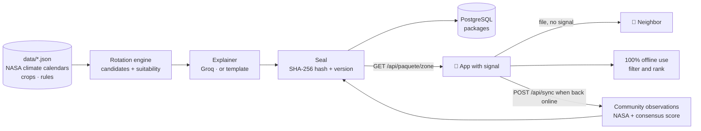
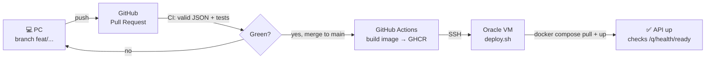

<p align="center">
  <picture>
    <source media="(prefers-color-scheme: dark)" srcset="docs/img/muyuy-logo-blanco.png">
    
  </picture>
</p>

<p align="center">
  <b>Backend + Core</b> · NASA Space Apps Challenge 2026 · <i>Field Shift: Adapting Farms with NASA Data</i> · Pilot: Huánuco, Peru
</p>

**Muyuy** (Quechua for *"to turn, to rotate"*) helps smallholder farmers choose **crop rotations** adapted to a changing climate.
The backend turns **NASA POWER** climate data, an Andean crop table and agronomic rules into a sealed **regional package**
with all candidate rotations, scored and explained. The app downloads it once and works **100% offline**.

The landing page and the Flutter app live in a separate repository: `muyuy-app` (link here).

📘 **Spec v2.1 (ES):** [docs/SPECS_v2.md](docs/SPECS_v2.md) · 📋 **Progress log (ES):** [docs/SPECS.md](docs/SPECS.md) · 🛰️ **NASA API tester:** [docs/ApisNASA.html](docs/ApisNASA.html) (download and open it in a browser)

🌐 **Live API:** https://muyuy-bk.rdev7.net.pe/q/swagger-ui · health: https://muyuy-bk.rdev7.net.pe/q/health/ready

> JSON field names are in Spanish (frozen contract with the app). Every field is documented in English at `/q/swagger-ui`.

## How it works

### 1. From NASA data to the field (offline-first)



1. The server **builds each zone's package**: NASA climate calendar + crops + **all** candidate rotations, already scored and explained.
2. It **seals** it: SHA-256 `hash` of the content and a `version` that increases only when the content changes.
3. The app calls `GET /api/paquete/{zone}/version` and downloads the package only if there is a newer version (~2 KB gzipped).
4. The app **verifies the hash**, filters by the farmer's current crop and ranks by their priorities, **offline**.
5. The package can be shared phone to phone; the receiver verifies the hash again.
6. Field observations (frost, drought…) recorded offline are synced later, auto-scored against NASA climate and neighbor consensus; validated ones become alerts in the next package.

**Design principles:** the engine is deterministic (same data → same rotations); AI only *explains*, it never decides; every score carries a confidence level based on data quality.

| Endpoint | Purpose |
|---|---|
| `GET /api/salud` | Is the server reachable? |
| `GET /api/zonas` | Official zones |
| `GET /api/paquete/{zone}/version` | Is there a newer package? |
| `GET /api/paquete/{zone}` | Full sealed package |
| `POST /api/dispositivos` | Anonymous device registration → token |
| `POST /api/sync` | Observations and connections saved offline (auto-validation: NASA + consensus) |

Full, documented contract: `/q/swagger-ui`.

### 2. NASA data used

| Source | Use |
|---|---|
| **NASA POWER** (1985–2024, monthly) | Frost probability, rainfall, evapotranspiration, water balance, heat stress, min/max temperature per zone |
| GIBS / SMAP / others | Explored for future layers (see `docs/ApisNASA.html`) |

`data/calendario_<zone>.json` summarizes NASA POWER by month. **Current files are placeholders** (`"anios": 0`) and are
replaced by real data with the same shape. Crop parameters follow FAO ECOCROP / FAO-56.

### 3. Code change to production (PC → Oracle Cloud)



### Architecture

```
Flutter app / Landing ──HTTPS──► Caddy (automatic TLS, Let's Encrypt) ──► Quarkus :8080 ──► PostgreSQL
                                                                    ├─ api/   REST endpoints
                                                                    ├─ ai/    explanations (Groq)
                                                                    └─ core/  engine, packages, community ◄── data/*.json (NASA POWER)
```

| Folder | Contents |
|---|---|
| `backend/src/main/java/pe/muyuy/core/` | models, data repositories, rotation engine, package sealing, community scoring |
| `backend/src/main/java/pe/muyuy/api/` | REST endpoints |
| `backend/src/main/java/pe/muyuy/ai/` | Groq explainer (template fallback) |
| `data/` | `calendario_*.json` (NASA), `cultivos.json`, `reglas.json`, `zonas.json` |
| `scripts/` | data scripts (NASA POWER, placeholder calendars) |
| `specs/` | feature specs (spec-kit, Spanish) |
| root | `docker-compose.yml`, `Caddyfile`, `deploy.sh`, `.github/` |

**Stack:** Java **25** everywhere (pom `release 25`, CI and Docker on Temurin 25), Quarkus 3.40, PostgreSQL + Flyway, Docker + Caddy.

## Run locally

Config in `backend/src/main/resources/`: `application.yml` (base + dev) · `application-test.yml` · `application-prod.yml`.

**Requires:** JDK 25 and a local PostgreSQL with databases `muyuy` (dev) and `muyuy_test` (tests), user `postgres`. Flyway creates the tables at startup.
Local variables: copy `backend/.env.example` to `backend/.env` (Quarkus reads it automatically; never committed).

| Profile | Command (from `backend/`; on Windows `mvnw.cmd`) |
|---|---|
| **dev** (live reload) | `./mvnw quarkus:dev` |
| **test** (all tests) | `./mvnw verify` |
| **prod** on your PC | `./mvnw package -DskipTests` then `MUYUY_DATA_DIR=../data java -jar target/quarkus-app/quarkus-run.jar` |
| **prod** in Docker (like Oracle) | from the root: `cp .env.example .env` then `docker compose up -d --build` |

PowerShell, prod: `$env:MUYUY_DATA_DIR="../data"; java -jar target/quarkus-app/quarkus-run.jar`

- http://localhost:8080/ → hello
- http://localhost:8080/q/health/ready → checks data files and database
- http://localhost:8080/q/swagger-ui → **API contract**

## Workflow

- Branches `feat/<topic>` → **PR to `main`**. CI runs the tests and validates the JSON files.
- The JSON contract is frozen: fields can only be **added**.
- Secrets only in `.env` (see `.env.example`), never in GitHub.

## Deployment (GitHub Actions → Oracle Cloud)

Every push to `main` runs `.github/workflows/deploy.yml`: tests → GitHub builds the image (`backend/Dockerfile.ci`, arm64 + amd64) and pushes it to GHCR → SSH to the VM → `deploy.sh` (`git reset` to `main` + `docker compose pull` + `up --no-build`) → checks `https://$API_DOMAIN/q/health/ready`. The VM never compiles.

### One-time VM setup (Ubuntu 24.04 ARM, Oracle A1)
```bash
sudo apt update && sudo apt install -y docker.io docker-compose-v2 docker-buildx git
sudo usermod -aG docker $USER            # log out and back in
# Ports 80/443: open them in the Security List AND in iptables

# Read-only deploy key while the repo is private: GitHub → Settings → Deploy keys
ssh-keygen -t ed25519 -f ~/.ssh/github_muyuy -N "" && cat ~/.ssh/github_muyuy.pub
printf 'Host github.com\n  IdentityFile ~/.ssh/github_muyuy\n' >> ~/.ssh/config

sudo mkdir -p /opt/muyuy && sudo chown $USER /opt/muyuy
git clone git@github.com:<org>/muyuy.git /opt/muyuy
cp /opt/muyuy/.env.example /opt/muyuy/.env && nano /opt/muyuy/.env   # API_DOMAIN, DB_PASSWORD, GROQ_API_KEY, CORS_ORIGINS
bash /opt/muyuy/deploy.sh                                            # first manual deploy
```

### SSH key for GitHub Actions
```bash
ssh-keygen -t ed25519 -f muyuy_actions -N "" -C "github-actions"
# Add muyuy_actions.pub to ~/.ssh/authorized_keys on the VM
```

### GitHub settings
| Type | Name | Value |
|---|---|---|
| Environment | `produccion` | (optional: require approval) |
| Secret | `ORACLE_HOST` | VM public IP |
| Secret | `ORACLE_USER` | `ubuntu` |
| Secret | `ORACLE_SSH_KEY` | contents of `muyuy_actions` (private key) |
| Variable | `API_DOMAIN` | `muyuy-bk.rdev7.net.pe` |

Protect `main`: required PR + green `test` check.

## AI usage

Rotation explanations are generated with **Groq (`openai/gpt-oss-120b`)** from the engine's deterministic output; when unavailable, a fixed template is used.
AI never chooses or scores rotations. Model choice backed by an evaluation on real data: [docs/ai-model-evaluation.md](docs/ai-model-evaluation.md).

## License

MIT
