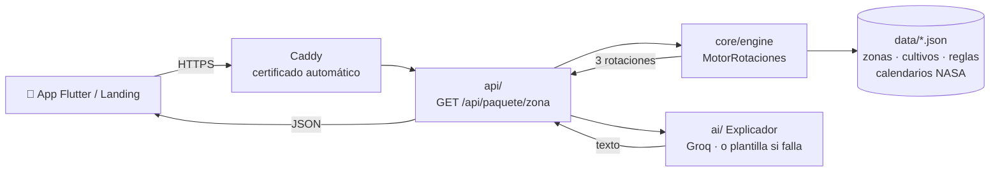

<p align="center">
  <picture>
    <source media="(prefers-color-scheme: dark)" srcset="docs/img/muyuy-logo-blanco.png">
    
  </picture>
</p>

<p align="center">
  <b>Backend + Núcleo</b> · NASA Space Apps Challenge 2026 · <i>Field Shift: Adapting Farms with NASA Data</i> · Piloto: Huánuco, Perú
</p>

Recomienda **rotaciones de cultivo** (actual + 2 alternativas) con puntajes y nivel de confianza,
a partir del calendario climático de **NASA POWER**, una tabla de cultivos andinos y reglas agronómicas.

La landing y la app Flutter viven en otro repositorio: `muyuy-app` (enlace aquí).

📘 **Especificación v2.1:** [docs/SPECS_v2.md](docs/SPECS_v2.md) · 📋 **Avance:** [docs/SPECS.md](docs/SPECS.md) · 🛰️ **Probador de APIs NASA:** [docs/ApisNASA.html](docs/ApisNASA.html) (descárgalo y ábrelo con doble clic)

## ¿Cómo funciona?

### 1. Una consulta (de la app al motor)



1. El agricultor elige su zona en la app.
2. La API busca la **zona** y su **calendario NASA** en `data/`.
3. El **motor** devuelve 3 rotaciones: la actual + 2 mejores, con puntajes y confianza.
4. El **Explicador** las cuenta en lenguaje sencillo (Groq; si falla, usa una plantilla).
5. La app recibe un solo JSON con todo.

> Hoy el motor activo es `MotorFalso` (respuestas fijas). Cuando `MotorReal` esté listo, lo reemplaza sin tocar la API.

### 2. Un cambio de código (de tu PC a Oracle)

```mermaid
flowchart LR
    P[💻 Tu PC<br/>rama feat/...] -- push --> G[GitHub<br/>Pull Request]
    G -- CI: JSON válidos + pruebas --> R{¿Verde?}
    R -- no --> P
    R -- sí, merge a main --> DP[Deploy Oracle<br/>GitHub Actions]
    DP -- SSH --> VM[VM Oracle<br/>deploy.sh]
    VM -- docker compose up --build --> OK[✅ API arriba<br/>verifica /q/health/ready]
```

### Piezas

```
App Flutter / Landing ──HTTPS──► Caddy (TLS automático, sslip.io) ──► Quarkus :8080
                                                                    ├─ api/   endpoints REST
                                                                    ├─ ai/    explicaciones (Groq)
                                                                    └─ core/  motor + datos ◄── data/*.json (NASA POWER)
```

| Carpeta | Dueño | Qué hay |
|---|---|---|
| `backend/src/main/java/pe/muyuy/core/` | Líder | modelos, repositorios, `MotorRotaciones` (Falso → Real), `Explicador` |
| `backend/src/main/java/pe/muyuy/api/` | Compañero API/Flutter | endpoints REST |
| `backend/src/main/java/pe/muyuy/ai/` | Compañero API/Flutter | `Explicador` con Groq |
| `data/` | Datos + líder | `calendario_*.json` (NASA), `cultivos.json`, `reglas.json`, `zonas.json` |
| `scripts/` | Datos | script NASA POWER · `datos_falsos.py` (calendarios inventados) |
| raíz | Líder | `docker-compose.yml`, `Caddyfile`, `deploy.sh`, `.github/` |

**Versiones:** Java **25** en todo (pom `release 25`, CI y Docker con Temurin 25). Requiere JDK 25 en local. Quarkus 3.40.

## Correr en local

Configuración en `backend/src/main/resources/`: `application.yml` (base + dev) · `application-test.yml` · `application-prod.yml`.

**Requisito:** PostgreSQL local (p. ej. Laragon) con las bases `muyuy` (dev) y `muyuy_test` (pruebas), usuario `postgres`. Flyway crea las tablas al arrancar. Otra conexión: `DB_URL`, `DB_USER`, `DB_PASSWORD` / `TEST_DB_URL`, `TEST_DB_USER`.

| Perfil | Comando (desde `backend/`; en Windows `mvnw.cmd`) |
|---|---|
| **dev** (recarga en caliente) | `./mvnw quarkus:dev` |
| **test** (todas las pruebas) | `./mvnw verify` |
| **prod** en tu PC | `./mvnw package -DskipTests` y luego `MUYUY_DATA_DIR=../data java -jar target/quarkus-app/quarkus-run.jar` |
| **prod** en Docker (como Oracle) | desde la raíz: `cp .env.example .env` y `docker compose up -d --build` |

En PowerShell, para prod: `$env:MUYUY_DATA_DIR="../data"; java -jar target/quarkus-app/quarkus-run.jar`
- http://localhost:8080/ → hola
- http://localhost:8080/q/health/ready → valida que carguen los JSON de `data/`
- http://localhost:8080/q/swagger-ui → **contrato de la API** (para el equipo de la app)

Pruebas: `./mvnw verify`

## Flujo de trabajo

- Ramas `feat/<tema>` → **PR a `main`** (el líder aprueba). La CI corre pruebas y valida los JSON.
- **Solo el líder** edita `pom.xml`, `application.properties`, `docker-compose.yml`, `Caddyfile`, `.github/`.
- Contrato JSON congelado desde el **sábado 9:00**: solo se **agregan** campos.
- Secretos solo en `.env` (ver `.env.example`). Nunca en GitHub.

## Despliegue (GitHub Actions → Oracle)

Cada push a `main` ejecuta `.github/workflows/deploy.yml`: pruebas → SSH a la VM → `deploy.sh` (`git reset` a `main` + `docker compose up -d --build`) → verifica `https://$API_DOMAIN/q/health/ready`.

### Preparar la VM una sola vez (Ubuntu 24.04 ARM, Oracle A1)
```bash
sudo apt update && sudo apt install -y docker.io docker-compose-v2 git
sudo usermod -aG docker $USER            # salir y volver a entrar
# Puertos 80/443: Security List en la consola Y iptables (ver ROL_BACKEND_LIDER.md §3.2)

# Llave para que la VM lea el repo (mientras sea privado): GitHub → Settings → Deploy keys (solo lectura)
ssh-keygen -t ed25519 -f ~/.ssh/github_muyuy -N "" && cat ~/.ssh/github_muyuy.pub
printf 'Host github.com\n  IdentityFile ~/.ssh/github_muyuy\n' >> ~/.ssh/config

sudo mkdir -p /opt/muyuy && sudo chown $USER /opt/muyuy
git clone git@github.com:<org>/muyuy.git /opt/muyuy
cp /opt/muyuy/.env.example /opt/muyuy/.env && nano /opt/muyuy/.env   # API_DOMAIN, GROQ_API_KEY, CORS_ORIGINS
bash /opt/muyuy/deploy.sh                                            # primer despliegue manual
```

### Llave para que GitHub Actions entre a la VM
```bash
# En tu PC:
ssh-keygen -t ed25519 -f muyuy_actions -N "" -C "github-actions"
# Agrega muyuy_actions.pub a ~/.ssh/authorized_keys de la VM
```

### Configuración en GitHub (Settings)
| Tipo | Nombre | Valor |
|---|---|---|
| Environment | `produccion` | (opcional: exigir aprobación) |
| Secret | `ORACLE_HOST` | IP pública de la VM |
| Secret | `ORACLE_USER` | `ubuntu` |
| Secret | `ORACLE_SSH_KEY` | contenido de `muyuy_actions` (privada) |
| Variable | `API_DOMAIN` | `api.150-1-2-3.sslip.io` |

Protección de `main`: PR obligatorio + check `test` en verde. Opcional: activa `.github/CODEOWNERS`.

## Datos NASA

`data/calendario_<zona>.json` resume 1985–2024 de NASA POWER por mes: probabilidad de helada, lluvia, ET,
balance hídrico, estrés por calor y temperaturas. **Los archivos actuales son inventados** (`"anios": 0`)
y se reemplazan por los reales con la misma forma.

## Licencia

MIT
