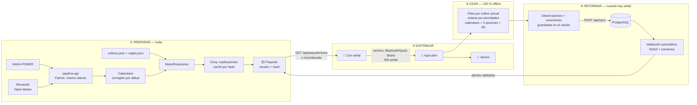

# 🌱 Muyuy — Especificación de implementación v2.1

> NASA Space Apps Challenge 2026 · Reto *"Field Shift: Adapting Farms with NASA Data"*
> Zona piloto: **Huánuco, Perú** · Entrega: **domingo 15/11, 23:59** (meta interna: 21:00)
> Este documento **reemplaza** el flujo anterior "app → servidor en cada consulta". Agregar a `docs/SPECS.md` y registrar en la bitácora.
>
> **Cambios v2.1:** back-office y roles **fuera del MVP** (quedan como diseño de gobernanza) · **modo demo** para jueces con **Huánuco + su propia ubicación** · servicio `pipeline-api` · endpoint `/api/paquete/coordenada` · cultivos globales · inicio de siembra calculado.

---

## 0. Índice

1. Visión y principios
2. Arquitectura general (4 etapas + generación bajo demanda)
3. Paquetes regionales
4. Motor de recomendación
5. Fuentes de datos de cultivos
6. Métricas de calidad (meta 70–90 %)
7. Usuarios en el MVP
8. Validación de datos y anti-bots
9. Red comunitaria (grafo)
10. Modo demo para jueces (Huánuco + tu ubicación)
11. API
12. Base de datos (PostgreSQL)
13. Infraestructura
14. Renovación de datos (cron)
15. Privacidad y seguridad
16. Alcance del fin de semana y prioridades
17. Cronograma por rol
18. Diseño de gobernanza (fuera del MVP)
19. Mensajes clave para el pitch
20. Bitácora de decisiones

---

## 1. 🎯 Visión y principios

> **Muyuy lleva décadas de datos de la NASA hasta la chacra, incluso sin señal: convierte el clima en un calendario y propone rotaciones explicables, pero la decisión es del agricultor.**

| # | Principio | Consecuencia técnica |
|---|---|---|
| 1 | **Offline primero** | La app **nunca** necesita internet en el momento de usarla |
| 2 | **Lo pesado se hace una vez en la nube; lo liviano, en el celular** | El servidor precalcula paquetes; la app filtra y ordena |
| 3 | **La IA explica, no decide** | Las recomendaciones salen de un motor determinista con datos NASA; Groq solo redacta |
| 4 | **Los datos viajan de celular a celular** | Paquetes como archivos verificables, compartibles sin red |
| 5 | **El agricultor decide; lo que observa vuelve** | Observaciones de campo → validación automática → próximo paquete |
| 6 | **Nunca mostrar un dato viejo como nuevo** | Versión, hash y vigencia por sección |
| 7 | **Honestidad con la incertidumbre** | Confianza por factor, fuente de cada dato y aviso de "no validada localmente" |
| 8 | **Funciona en cualquier lugar; validado en Huánuco** | Mismo cálculo para zonas oficiales y para cualquier coordenada |

---

## 2. 🏗️ Arquitectura general

**El servidor NO está en el camino del uso diario.** Prepara paquetes, los genera bajo demanda cuando hay señal y recibe observaciones.



| Etapa | Dónde | Internet | Frecuencia |
|---|---|---|---|
| ① Preparar (zonas oficiales) | Oracle VM | Sí | Programada (sección 14) |
| ① Preparar (cualquier coordenada) | Oracle VM, bajo demanda | Sí | Al pedirla, con caché por celda |
| ② Distribuir | API o celular a celular | Solo el primer celular | Cuando hay versión nueva |
| ③ Usar | Celular / navegador | **No** | Cada uso |
| ④ Retornar | Celular → API | Sí (cuando la haya) | Oportunista |

**Dos orígenes de paquete, mismo formato:**

| Origen | Ejemplo | Validación local | Confianza máxima |
|---|---|---|---|
| `zona_oficial` | `huanuco-sierra`, `huanuco-valle`, `huanuco-selva`, `global-demo` | ✅ Huánuco (MIDAGRI + campo) | Alta |
| `coordenada` | Ubicación del juez o del agricultor | ❌ | **Media** + aviso 🟡 |

---

## 3. 📦 Paquetes regionales

### 3.1 Propiedad
- El paquete **no pertenece al usuario**: es dato público generado y sellado por el servidor.
- El usuario es **mensajero**. La validez la da el **hash**, no quién lo compartió.
- Lo que **sí** genera el usuario: **observaciones** y **conexiones** (a quién compartió).

### 3.2 Estructura del archivo

```json
{
  "sobre": {
    "compartido_por": "disp-7f3a",
    "fecha_compartido": "2026-11-15T09:12:00Z"
  },
  "paquete": {
    "meta": {
      "formato": 2,
      "origen": "zona_oficial",
      "zona": "huanuco-sierra",
      "celda": null,
      "validada_localmente": true,
      "idioma": "es",
      "version": 12,
      "generado": "2026-11-14T20:00:00Z",
      "hash": "sha256:9c1e...",
      "secciones": {
        "calendario":  { "actualizado": "2026-11-01", "valido_hasta": "2027-02-01" },
        "condiciones": { "actualizado": "2026-11-10", "valido_hasta": "2026-11-24" },
        "alertas":     { "actualizado": "2026-11-14", "valido_hasta": "2026-11-21" }
      },
      "extras": ["imagen"]
    },
    "nucleo": {
      "zona":        { "id": "huanuco-sierra", "nombre": "Sierra de Huánuco, Perú",
                       "lat": -9.90, "lon": -75.99, "elevacion_m": 3200 },
      "fuente_clima": "NASA POWER (AG), 1985-2024, corregido por altitud",
      "inicio_siembra_mes": 10,
      "calendario":  [ { "mes": 6, "prob_helada": 0.70, "dias_helada": 6.2,
                         "lluvia_mm": 8.0, "et_mm": 95.0, "balance_hidrico_mm": -87.0,
                         "estres_calor": 0.0, "t_min": -0.8, "t_max": 17.5 } ],
      "condiciones": { "lluvia_30d_vs_normal": -0.30 },
      "cultivos":    [ { "id": "haba", "nombre": "Haba", "familia": "Fabaceae", "...": "..." } ],
      "rotaciones":  [ { "id": "R03", "cultivo_inicial": "papa",
                         "secuencia": ["papa", "haba", "avena_forrajera"],
                         "puntajes":  { "agua": 0.7, "suelo": 0.9, "ingresos": 0.6, "riesgo": 0.8 },
                         "confianza": { "clima": "alta", "agua": "alta", "suelo": "media", "mercado": "sin_datos" },
                         "explicacion": "El haba fija nitrógeno después de la papa...",
                         "validar_con_experto": "Confirma si hay semilla de haba en tu zona.",
                         "es_practica_comun": false } ],
      "alertas_comunidad": [ { "tipo": "helada", "fecha": "2026-06-18", "confirmaciones": 3 } ]
    },
    "extras": {
      "imagen_satelital_b64": "..."
    }
  }
}
```

- **`sobre`**: cambia cada vez que se comparte; **fuera del hash**.
- **`hash`**: SHA-256 del JSON canónico de `nucleo` + `extras` (claves ordenadas, sin espacios).
- **`origen`** / **`celda`** / **`validada_localmente`**: distinguen zona oficial de coordenada (para `coordenada`: `"zona": null`, `"celda": "-0.5_36.0"`).
- **`idioma`**: idioma de las explicaciones (`es` / `en`).
- **`inicio_siembra_mes`**: fijo en zonas oficiales; calculado en coordenadas (sección 4.6).
- **`rotaciones`**: **todas las candidatas (6–10)**. La app elige.
- **`es_practica_comun`**: rotación tradicional para mostrar como "tu rotación actual" (solo zonas oficiales).

### 3.3 Tamaños

| Parte | Tamaño aprox. | MVP |
|---|---|---|
| Núcleo (calendario + cultivos + 10 rotaciones + alertas) | 15–20 KB (~5 KB gzip) | ✅ |
| Imagen satelital (Worldview Snapshot, JPEG 600×600) | 60–100 KB | ✅ zonas oficiales |
| Grilla de elevación para el 3D | ~15 KB | ⏭️ |
| Audios en quechua | 50–150 KB c/u | ⏭️ |

**Fuera del paquete:** motor 3D (Three.js, viene en la app) y Gemma (descarga aparte, opcional).

### 3.4 Ciclo de vida

```
① GENERAR    pipeline + motor + Groq → contenido
② SELLAR     version++ SOLO si el hash cambió · fecha · vigencias
③ GUARDAR    /app/paquetes/{zona|celda}/v{n}.json.gz + fila en `paquetes`
④ DISTRIBUIR API (con señal) o archivo celular a celular
⑤ VERIFICAR  la app recalcula el hash → si no coincide, rechaza
⑥ INSTALAR   solo si version > la instalada ("gana la más nueva")
⑦ ENVEJECER  indicador 🟢🟡🔴 por sección
```

### 3.5 Compartir sin señal
- **Archivo** `.muyuy` (JSON gzip) vía `share_plus` → Quick Share / Bluetooth.
- **QR** = solo `{zona|celda, version, hash corto, compartido_por}`. Sirve para comparar versiones y registrar la conexión.
- Al importar: verificar hash → comparar versión → instalar o descartar → registrar conexión `COMPARTIO`.

---

## 4. 🧠 Motor de recomendación (backend)

### 4.1 Responsabilidad
El **backend** precalcula las **rotaciones candidatas** con puntajes por factor, confianza y explicación. La **app** solo filtra y ordena (offline).

### 4.2 Simplificaciones del MVP
- **1 cultivo por campaña (año)**, sembrado en `inicio_siembra_mes`.
- Rotación = **3 campañas**.

### 4.3 Algoritmo

1. **Aptitud** `esApto(zona, cultivo, calendario)`, todas deben cumplirse:
   - Temperatura media del ciclo dentro de `t_opt_min − 3` … `t_opt_max + 3` °C.
   - Ningún mes del ciclo con `t_min` < `ktmp` (temperatura letal) en más del 50 % de los años.
   - Lluvia del **ciclo** (no anual) ≥ 60 % de su necesidad, o la zona tiene riego.
   - En zonas oficiales, además: el cultivo está en `zonas[]` **o** su clima lo permite.
2. **Generar** secuencias de 3 campañas desde cada cultivo inicial (zonas oficiales: los comunes de la zona; coordenadas: los 3 más aptos).
3. **Descartar** las que violan reglas prohibidas (misma familia seguida; papa → papa salvo `es_practica_comun`).
4. **Puntuar** (0–1):

| Factor | Cálculo |
|---|---|
| `agua` | Promedio por cultivo: baja = 1.0 · media = 0.7 · alta = 0.4 · −0.1 por mes seco dentro del ciclo |
| `suelo` | 0.3 base + 0.3 si hay leguminosa + 0.2 si hay 3 familias + 0.2 si termina en cobertura o forraje |
| `ingresos` | Promedio de `valor_mercado` (coordenadas: 0.5 neutro) |
| `riesgo` (1 = seguro) | 1 − promedio de la probabilidad de daño por helada y sequía en el ciclo |

5. **Seleccionar** las 6–10 mejores por cultivo inicial, **diversas** (sin repetir el cultivo de la 2.ª campaña), más la práctica común si existe.
6. **Confianza por factor:**

| Factor | Zona oficial | Coordenada |
|---|---|---|
| `clima` | `alta` (≥ 30 años NASA) | `alta` (mismo dato NASA ≥ 30 años) |
| `agua` | `alta` con lluvia y ET | `media` |
| `suelo` | `media` | `media` |
| `mercado` | `sin_datos` salvo precio MIDAGRI | `sin_datos` |

7. **Explicación:** `Explicador` (Groq) en el `idioma` pedido, con caché por hash de entrada; plantilla si Groq falla.

### 4.4 En la app (offline)

```dart
// 1. Filtrar por el cultivo actual del agricultor
final candidatas = paquete.rotaciones
    .where((r) => r.cultivoInicial == cultivoActual).toList();
// 2. Ordenar por sus prioridades
candidatas.sort((a, b) =>
    puntajeFinal(b.puntajes, prioridades).compareTo(puntajeFinal(a.puntajes, prioridades)));
// 3. Mostrar: práctica común (si existe) + las 2 mejores
```

### 4.5 Interfaces

```java
public interface MotorRotaciones {
    List<Rotacion> recomendar(Zona zona, Calendario calendario, Set<Cultivo> catalogo); // TODAS las candidatas
    boolean esApto(Zona zona, Cultivo cultivo, Calendario calendario);                // para evaluación
}
public interface Explicador {
    String explicar(Rotacion rotacion, Zona zona, Calendario calendario, String idioma);
}
```

`catalogo` = cultivos andinos (zonas de Huánuco) o **globales** (coordenadas y `global-demo`).

### 4.6 Modo global (coordenadas)

| Tema | Zonas de Huánuco | Cualquier coordenada |
|---|---|---|
| Catálogo | 15 andinos | **~30 globales** (sección 5) |
| `inicio_siembra_mes` | 10 (octubre) | **Calculado**: primer mes de la racha más larga con `lluvia ≥ 0.5 × ET`. Si no hay estación seca, primer mes sin helada (`prob_helada < 0.2`). Si todo el año es apto, mes 1. |
| Cultivo inicial | Práctica común de la zona | Los 3 cultivos más aptos |
| Mercado | MIDAGRI | `sin_datos` (ingresos = 0.5) |
| Idioma | Español | Según el navegador (`es` / `en`) |
| Aviso | — | 🟡 *"Calculado con 40 años de datos NASA. Aún sin validación de campo en esta zona"* |
| Cerca de zona oficial (≤ 30 km) | — | Se entrega el **paquete validado** de esa zona |
| Exceso de lluvia | Lluvia del ciclo > 2.2 × máximo del cultivo → no apto | Igual |

---

## 5. 📚 Fuentes de datos de cultivos

| Dato | Fuente | Campo |
|---|---|---|
| T° óptima y límites, **T° letal**, lluvia óptima, duración del ciclo | **FAO ECOCROP** (`EcoCrop_DB.csv`, repo GitHub `openclim/ecocrop`) | `t_opt_*`, `ktmp`, `lluvia_opt_*`, `ciclo_meses` |
| Consumo de agua por etapa | **FAO-56** (coeficientes Kc) | `agua`, `kc[]` |
| Familia, fijación de N, raíz | Botánica estándar | `familia`, `fija_nitrogeno`, `raiz_profunda` |
| ¿Se siembra en la zona? | **MIDAGRI / SIEA** (estadística por provincia) | `zonas[]` + verdad para la evaluación |
| Precio | **MIDAGRI** (mercados mayoristas) | `valor_mercado` |
| Reglas de rotación | **INIA** + literatura + práctica andina | `reglas.json` |

### Conversión ECOCROP → `cultivos.json`

| ECOCROP | Campo | Conversión |
|---|---|---|
| `TOPMN` / `TOPMX` | `t_opt_min` / `t_opt_max` | Directo |
| `KTMP` | `ktmp` + `tolera_helada` | ≤ −4 → alta · −4…0 → media · > 0 → baja |
| `ROPMN` / `ROPMX` | `lluvia_opt_min/max` + `agua` | media < 500 → baja · 500–1000 → media · > 1000 → alta |
| `GMIN` / `GMAX` | `ciclo_meses` | promedio ÷ 30 |

### Trazabilidad (obligatoria)

```json
"fuente": { "clima": "FAO ECOCROP", "agua": "FAO-56",
            "zona": "MIDAGRI-SIEA Huánuco", "notas": "KTMP completado con literatura INIA" }
```

### Catálogos
- **`cultivos_andinos.json` (15):** papa, olluco, oca, haba, arveja, tarwi, quinua, cebada, avena forrajera, trigo, maíz amiláceo, frijol, maíz amarillo duro, yuca, mucuna.
- **`cultivos_globales.json` (~30):** maíz, trigo, arroz, sorgo, mijo, cebada, avena, soya, frijol, garbanzo, lenteja, arveja, caupí, maní, haba, papa, camote, yuca, quinua, girasol, colza, algodón, caña de azúcar, alfalfa, trébol, mucuna, tomate, cebolla, repollo, plátano.

---

## 6. 📏 Métricas de calidad (meta 70–90 %)

| # | Métrica | Verdad de referencia | Meta | Fin de semana |
|---|---|---|---|---|
| 1 | **Acierto del calendario** | Backtesting: calibrar con 1985–2014, verificar 2015–2024 | 80–90 % | ✅ |
| 2 | **Acierto de aptitud** ⭐ | MIDAGRI: qué se siembra en cada provincia (~60 pares zona × cultivo) | 80–90 % | ✅ |
| 3 | **Cumplimiento de reglas** | Pruebas JUnit | 100 % | ✅ |
| 4 | **Acuerdo de expertos** | Agricultor / agrónomo: "¿es razonable?" | ≥ 70 % | 🟡 Muestra pequeña |
| 5 | Mejora de rendimiento | Pilotos de campo por temporadas | — | ⏭️ |

**Reglas de honestidad:**
- Ajustar umbrales con **sierra + valle**; medir el resultado final con **selva + Kenia**.
- Reportar siempre el tamaño de la muestra: *"86 % en 60 casos"*.
- Publicar la **matriz de confusión** (falsos aptos ≠ falsos no aptos).
- No prometer rendimiento. Las métricas aplican a **Huánuco**; las coordenadas libres no están validadas.

`pipeline/evaluacion.py` → `docs/evaluacion.md` con resultados.

---

## 7. 👥 Usuarios en el MVP

| Usuario | Registro | Cómo usa Muyuy |
|---|---|---|
| 👨‍🌾 **Agricultor** | ❌ Nunca | UUID anónimo generado al primer uso; todo offline; sincroniza en segundo plano cuando hay señal |
| 👩‍⚖️ **Juez** | ❌ Nunca | Modo demo web: Huánuco o su ubicación (sección 10) |
| ⚙️ **Equipo (operación)** | — | Por **SSH** a la VM: `cron`, `./regenerar.sh`, consultas a PostgreSQL |

### Flujo del agricultor
```
Primer uso:  recibe app + paquete → abre → ID anónimo → importa paquete (verifica hash)
             → "Mi chacra" (zona/ubicación, cultivo actual, riego, 2 prioridades)
             → calendario + 3 rotaciones + explicación + 3D
Sin señal:   consulta · registra observaciones · comparte paquete (guarda "yo → vecino")
Con señal:   POST /api/dispositivos (1.ª vez) → GET /version → POST /api/sync
             → ve el estado de sus reportes (⏳ / ✅)
```

**No hay back-office, roles ni códigos de promotor en el MVP.** Están diseñados en la sección 18.

---

## 8. 🛡️ Validación de datos y anti-bots

**Leer** (paquetes) es público. **Escribir** (observaciones, conexiones) está validado. **Sin CAPTCHA** (no funciona offline y excluye a quien lee poco). **Moderación automática** en el MVP.

| Capa | Qué hace | MVP |
|---|---|---|
| 1. Token de dispositivo | `POST /api/dispositivos` → token firmado; sin token no se acepta escritura | ✅ |
| 2. Límite | Máx. 50 observaciones por dispositivo y día · límite por IP en `/api/dispositivos` y `/coordenada` | ✅ |
| 3. Sentido común + **cruce NASA** | Fecha no futura, ubicación válida, rangos válidos; helada reportada con T mín. NASA > 2 °C → sospechosa | ✅ |
| 4. Confianza por promotor | Observación vía promotor verificado → bonus | ⏭️ |
| 5. Play Integrity API | App real en celular real | ⏭️ |

### Puntaje automático de una observación (0–100)

| Fuente | Peso MVP | Peso con gobernanza (futuro) |
|---|---|---|
| 🛰️ Coincide con NASA | **55** | 40 |
| 🤝 Consenso (otros dispositivos, misma zona, ±3 días) | **45** | 30 |
| 🕸️ Cercanía a un promotor verificado | — | 20 |
| 🛡️ Aprobación de moderador | — | 10 |

**≥ 70 → ✅ validada** (entra a `alertas_comunidad` del próximo paquete) · **40–69 → ⏳ pendiente** · **< 40 → ⚠️ sospechosa**.
Observaciones con `"demo": true` → **nunca** entran a la red real ni a las métricas.

---

## 9. 🕸️ Red comunitaria (grafo)

### 9.1 Nodos y conexiones (MVP)
| Conexión | Origen → destino | Nace |
|---|---|---|
| `COMPARTIO` | dispositivo → dispositivo | Al importar un paquete (offline) |
| `REPORTO` | dispositivo → observación | En la app |
| `CONFIRMA` | observación → observación | Servidor (consenso) |

*(`VERIFICADO_POR` y `PERTENECE_A` llegan con la gobernanza, sección 18.)*

### 9.2 Implementación
- **Sin base de datos de grafos**: tabla `conexiones` en PostgreSQL + `WITH RECURSIVE` para alcance y saltos.
- Las conexiones se guardan en el celular y viajan en `POST /api/sync`.

```sql
-- Alcance: cuántos dispositivos recibieron el paquete a partir de uno dado (máx. 5 saltos)
WITH RECURSIVE alcance(dispositivo, saltos) AS (
  SELECT :origen, 0
  UNION
  SELECT c.destino, a.saltos + 1
  FROM conexiones c JOIN alcance a ON c.origen = a.dispositivo
  WHERE c.tipo = 'COMPARTIO' AND a.saltos < 5
)
SELECT COUNT(DISTINCT dispositivo) - 1 AS alcanzados, MAX(saltos) AS saltos_max FROM alcance;
```

### 9.3 Métricas
- **Alcance** (dispositivos alcanzados desde un origen) · **saltos máximos**.
- **% de observaciones validadas con NASA**.
- **Crecimiento diario** (dispositivos, comparticiones, observaciones).
- Publicadas (anónimas) en `GET /api/red/publica` → página `/red`.

---

## 10. 👩‍⚖️ Modo demo para jueces (Huánuco + tu ubicación)

> **Regla Space Apps:** los enlaces entregados deben ser públicos, **sin contraseña ni registro**.

### 10.1 Recorrido

```
Landing → "Probar demo / Try the demo"
   ┌─────────────────────────────────────────────┐
   │  📍 Usar mi ubicación / Use my location      │
   │  🌄 Ver Huánuco, Perú (piloto validado)      │
   └─────────────────────────────────────────────┘
        │ permite ubicación                  │
        ▼                                    ▼
 GET /api/paquete/coordenada          Paquete Huánuco EMBEBIDO
 "Leyendo 40 años de datos NASA        (inmediato, sin servidor)
  de tu zona…" (5–20 s)
        │
        ▼
 Calendario + 3 rotaciones + explicación (es/en) + 🟡 "no validada localmente"
```

**Respaldo automático a Huánuco** si: el permiso se niega, la NASA o el servidor fallan, o la respuesta tarda > 30 s. El juez **nunca** ve una pantalla de error.

### 10.2 Reglas de la demo
- **Cada juez trabaja en su navegador**: varios jueces a la vez no se afectan entre sí.
- El paquete de Huánuco va **embebido** en la demo web (no consume el servidor).
- Observaciones de la demo → `"demo": true`; nunca contaminan los datos reales.
- Botón **"Reiniciar demo"** (borra el estado local).
- Pantalla de ubicación con aviso de privacidad: *"Solo usamos una celda de ~50 km para calcular; no guardamos tu ubicación."*
- **Precalcular** ubicaciones probables de los jueces (ej. Houston, Washington D. C., Lima, Nairobi, Nueva Delhi, Madrid) para respuesta inmediata.

### 10.3 Enlaces para la entrega
| Para el jurado | URL | Contenido |
|---|---|---|
| 📱 Demo web | `landing/demo` (`flutter build web`) | Huánuco o su ubicación, sin registro |
| 🕸️ Red pública | `landing/red` | Grafo + crecimiento + métricas, **anónimo** (si da el tiempo) |
| 🎥 Video | YouTube / Drive público | Uso real en campo |
| 💻 Repo | GitHub público | Código + `docs/evaluacion.md` |

**Datos de la red:** las conexiones de la **prueba de campo del domingo son reales**. Si se agregan **datos de demostración** para mostrar escala, se etiquetan **siempre** como *"Demo data"*.

---

## 11. 🔌 API

Todo bajo `https://api.147-224-236-134.sslip.io`.

| Método | Ruta | Auth | Descripción |
|---|---|---|---|
| GET | `/api/salud` | — | `{ "ok": true }` |
| GET | `/api/zonas` | — | Zonas oficiales |
| GET | `/api/paquete/{zona}/version` | — | `{ "version": 12, "hash": "..." }` |
| GET | `/api/paquete/{zona}` | — | Paquete de zona oficial (gzip) |
| GET | `/api/paquete/coordenada?lat=&lon=&lang=` | — (límite por IP) | **Paquete bajo demanda** para cualquier punto (sección 11.1) |
| POST | `/api/dispositivos` | — (límite por IP) | Registra el dispositivo → `{ token }` |
| POST | `/api/sync` | Token | `{ observaciones: [...], conexiones: [...] }` → `{ aceptadas, rechazadas }` |
| GET | `/api/red/publica` | — | Nodos y conexiones **anónimos** + métricas + serie temporal (excluye `demo`) |

**CORS** habilitado para el dominio de la landing (demo web).

### 11.1 `/api/paquete/coordenada`

```
1. Validar lat ∈ [-60, 60], lon ∈ [-180, 180]; lang ∈ {es, en} (por defecto en)
2. Celda = redondeo a 0.5° (malla de NASA POWER) → clave de caché "celda|lang"
3. ¿En caché? → responder al instante
4. Elevación local: Open-Meteo Elevation API (sin clave) → si falla, sin corrección + aviso
5. pipeline-api: GET /calendario?lat=&lon=&elev=  (timeout 25 s)
6. Calcular inicio_siembra_mes (sección 4.6)
7. Motor con catálogo GLOBAL → candidatas
8. Groq en `lang` (caché por hash; plantilla si falla)
9. Sellar (origen = "coordenada", validada_localmente = false) → caché → responder
Errores: 504 si la NASA no responde a tiempo (la app cae a Huánuco)
```

### 11.2 Contrato de `/api/sync`

```json
{
  "observaciones": [
    { "id_local": "uuid", "zona_id": "huanuco-sierra", "celda": null, "tipo": "helada",
      "fecha_evento": "2026-06-18", "valor": null,
      "lat_aprox": -9.90, "lon_aprox": -75.99, "demo": false,
      "creado": "2026-06-18T07:10:00Z" }
  ],
  "conexiones": [
    { "origen": "disp-7f3a", "destino": "disp-yo", "tipo": "COMPARTIO",
      "paquete": "huanuco-sierra@12", "demo": false, "fecha": "2026-11-15T09:12:00Z" }
  ]
}
```

Idempotente por `id_local` (reenvíos no duplican).

### 11.3 `pipeline-api` (interno, sin puerto público)

| Método | Ruta | Descripción |
|---|---|---|
| GET | `/calendario?lat=&lon=&elev=` | Mismo cálculo que `pipeline/calendario.py` (NASA POWER 1985–2024, corrección por altitud, Hargreaves) |
| GET | `/salud` | Estado |

---

## 12. 🗄️ Base de datos (PostgreSQL 16)

> Calendarios, cultivos y reglas **NO** van en la base: son JSON versionados en `data/` (GitHub). La base guarda lo que **escriben** los usuarios y la caché de coordenadas.

### MVP
```sql
dispositivos   (id UUID PK, token_hash, demo BOOL, creado, ultimo_contacto, bloqueado BOOL)
observaciones  (id UUID PK, id_local UUID UNIQUE, dispositivo_id FK, zona_id NULL, celda NULL,
                tipo, fecha_evento DATE, valor NUMERIC NULL, lat_aprox, lon_aprox,
                puntaje INT, estado, motivo_sospecha NULL, demo BOOL, creado)
conexiones     (id BIGSERIAL PK, origen, destino, tipo, paquete NULL, demo BOOL, fecha,
                UNIQUE(origen, destino, tipo, paquete))
paquetes       (clave PK,                 -- "huanuco-sierra@12" o "-0.5_36.0|en@1"
                origen, zona_id NULL, celda NULL, idioma, version, hash,
                generado, ruta_archivo)
descargas      (clave_paquete, fecha)     -- solo conteo
```

Índices: `observaciones(zona_id, fecha_evento)`, `observaciones(celda, fecha_evento)`, `conexiones(origen)`, `conexiones(destino)`.

### Futuro (gobernanza, sección 18)
`organizaciones`, `usuarios_admin`, `usuario_zonas`, `invitaciones`, `auditoria`, `promotores` + columna `dispositivos.promotor_codigo`.

---

## 13. 🟠 Infraestructura

| Pieza | Tecnología |
|---|---|
| Servidor | Oracle Cloud **VM.Standard.A1.Flex** (ARM, 2 OCPU / 12 GB, Always Free) · Ubuntu 24.04 · región Chile West |
| IP / dominio | `147.224.236.134` → `api.147-224-236-134.sslip.io` |
| Proxy + HTTPS | **Caddy 2** (certificados automáticos) |
| Backend | **Quarkus 3.40 · Java 25** (JVM, Docker multiarquitectura) |
| Cálculo bajo demanda | **pipeline-api**: Python + FastAPI (mismo código del pipeline) |
| Base de datos | **PostgreSQL 16** en Docker (sin puerto público) |
| Pipeline programado | Python en la VM (`cron`) |
| Elevación para coordenadas | **Open-Meteo Elevation API** (gratis, sin clave; no es NASA → declarar en la entrega) |
| IA | Groq (`llama-3.3-70b-versatile`), con caché |
| Landing + demo web + `/red` | Cloudflare Pages |
| Administración | **SSH** (llave) + scripts |
| ~~Turso~~ | **Fuera del MVP** |

### `Caddyfile`
```
api.147-224-236-134.sslip.io {
    reverse_proxy backend:8080
}
```

### `docker-compose.yml`
```yaml
services:
  db:
    image: postgres:16
    restart: unless-stopped
    environment:
      POSTGRES_DB: muyuy
      POSTGRES_USER: muyuy
      POSTGRES_PASSWORD: ${DB_PASSWORD}
    volumes: [pgdata:/var/lib/postgresql/data]

  pipeline-api:
    build: ./pipeline
    restart: unless-stopped
    command: uvicorn servicio:app --host 0.0.0.0 --port 8000
    volumes:
      - pipeline_cache:/app/raw

  backend:
    build: ./backend
    restart: unless-stopped
    env_file: .env
    environment:
      QUARKUS_PROFILE: prod
      QUARKUS_DATASOURCE_JDBC_URL: jdbc:postgresql://db:5432/muyuy
      QUARKUS_DATASOURCE_USERNAME: muyuy
      QUARKUS_DATASOURCE_PASSWORD: ${DB_PASSWORD}
      MUYUY_PIPELINE_URL: http://pipeline-api:8000
    volumes:
      - ./data:/app/data:ro
      - paquetes:/app/paquetes
    depends_on: [db, pipeline-api]

  caddy:
    image: caddy:2
    restart: unless-stopped
    ports: ["80:80", "443:443"]
    volumes:
      - ./Caddyfile:/etc/caddy/Caddyfile:ro
      - caddy_data:/data
    depends_on: [backend]

volumes: { pgdata: {}, paquetes: {}, pipeline_cache: {}, caddy_data: {} }
```

### `.env` (solo en la VM, nunca en GitHub)
```
DB_PASSWORD=
GROQ_API_KEY=
TOKEN_SIGNING_KEY=      # firma de tokens de dispositivo (32+ caracteres)
```

### Scripts de operación (`scripts/`)
| Script | Uso |
|---|---|
| `deploy.sh` | `git pull` + `docker compose up -d --build` |
| `regenerar.sh [zona]` | Regenera paquetes de zonas oficiales |
| `precalcular.sh` | Genera la caché de ubicaciones probables de los jueces |
| `respaldo.sh` | `pg_dump` comprimido |

```bash
# crontab de la VM
0 3 1 * *  /opt/muyuy/scripts/regenerar.sh            # mensual: calendario + rotaciones
0 3 * * 1  /opt/muyuy/scripts/regenerar.sh --condiciones   # semanal
30 3 * * * /opt/muyuy/scripts/regenerar.sh --alertas       # diario
0 4 * * *  /opt/muyuy/scripts/respaldo.sh
```

---

## 14. 🔄 Renovación de datos

| Dato | Frecuencia | Vigencia | Disparador |
|---|---|---|---|
| Calendario (40 años) + rotaciones | Mensual | 3 meses | `cron` / `regenerar.sh` |
| Condiciones recientes (30 días vs. normal) | Semanal | 14 días | `cron` |
| Alertas de la comunidad | Diaria | 7 días | `cron` |
| Caché de coordenadas | Al pedirla | 30 días (luego se recalcula) | Petición |

**Reglas:**
- `version++` **solo si el hash cambió**.
- Groq **solo** para rotaciones nuevas o modificadas (caché por hash de entrada + idioma).
- Si la NASA falla: **se mantiene la última versión buena**. Nunca publicar un paquete incompleto.

**En la app:**
- Con señal, al abrir: `GET /version` → descarga solo si hay una versión mayor.
- Sin señal: **"gana la versión más nueva"** al importar → la actualización se propaga por la red.
- Indicador por sección: 🟢 vigente · 🟡 cerca de vencer · 🔴 vencido (sección atenuada + "pide la versión nueva a tu promotor").

---

## 15. 🔐 Privacidad y seguridad

- **Sin datos personales**: ni nombre, ni teléfono, ni DNI. Solo un UUID anónimo.
- **Ubicación redondeada** a ~1 km en observaciones; la ubicación de la demo **no se guarda** (solo la celda de ~50 km como clave de caché).
- `/api/red/publica` **sin** IDs reales (alias aleatorios por consulta) y **sin** datos `demo`.
- Tokens de dispositivo guardados como **hash**.
- Límite por IP en `/api/dispositivos` y `/api/paquete/coordenada`.
- PostgreSQL y `pipeline-api` **sin puerto público**; solo la red interna de Docker.
- SSH **solo con llave**; `.env`, `*.key`, `*.jks` y `key.properties` en `.gitignore`.
- Prueba de campo: **consentimiento** del agricultor; **sin menores** reconocibles; sin datos personales publicados.

---

## 16. ✂️ Alcance del fin de semana y prioridades

**Regla de oro:** nada de P1 o P2 se toca hasta que el **flujo offline funcione el sábado a las 21:00**.

| Prioridad | Entregable |
|---|---|
| 🔴 **P0 — Imprescindible** | Calendarios NASA corregidos por altitud (4 zonas) · `cultivos_andinos.json` (ECOCROP) + `reglas.json` · Motor con candidatas + `esApto` · Groq con caché + plantilla · Paquete con `version` + `hash` + vigencias · `GET /api/paquete/{zona}` y `/version` · App: filtrar + ordenar + calendario + 3 opciones, **100 % offline** · Compartir archivo + "gana la más nueva" · APK firmado |
| 🟡 **P1 — Importante** | **Modo demo web** con Huánuco embebido + "Reiniciar demo" · Evaluación de aptitud (métrica 2) + pruebas de reglas · **`pipeline-api` + `/api/paquete/coordenada`** + catálogo global + inicio de siembra calculado · Pantalla "Usar mi ubicación" con respaldo a Huánuco · PostgreSQL + `/api/dispositivos` + `/api/sync` + puntaje automático · Imagen satelital · Terreno 3D |
| 🟢 **P2 — Si sobra tiempo** | Página `/red` + `/api/red/publica` · Precalcular ubicaciones de jueces · Backtesting (métrica 1) · Explicaciones en inglés |
| ⏭️ **Siguiente fase (pitch)** | Gobernanza completa (sección 18) · Firma digital Ed25519 · Play Integrity · Audios en quechua · Gemma offline · SMAP/AppEEARS · Turso · Rendimiento medido en pilotos |

---

## 17. 📅 Cronograma por rol

### Sábado 14
| Hora | ⚙️ Backend (líder) | 🔌📱 API + Groq + App | 🛰️ Datos | 🌐 Landing |
|---|---|---|---|---|
| **9:00** | 🤝 Contrato v2.1 del paquete (sección 3.2) | | | |
| 9–10 | `MotorFalso` con candidatas + deploy | Esqueleto Flutter | Descarga NASA (4 zonas) | Terreno 3D |
| 10–14 | `cultivos_andinos.json` (ECOCROP) + `reglas.json` | API paquete + `/version` + Groq con caché | Cálculos + corrección por altitud | Terreno 3D → entrega a la app |
| **14:00** | 🔄 Calendarios reales | | 📦 Entrega | |
| 14–18 | `MotorReal` + `esApto` + pruebas | Pantallas con filtro/orden offline | Tabla de verdad MIDAGRI (~60 pares) + imagen satelital | Landing |
| 18–21 | Evaluación (métrica 2) + ajuste · PostgreSQL | App ↔ API real · hash + versión | `calendario_para_punto()` + `servicio.py` (FastAPI) | Publicar landing |
| **21:00** | 🔴 **HITO: flujo completo offline con datos reales de Huánuco** | | | |
| 21–24 | `/api/dispositivos` + `/api/sync` · `/api/paquete/coordenada` (inicio) | Compartir archivo + "gana la más nueva" + **APK en 2 celulares** | `cultivos_globales.json` (~30, ECOCROP) | Diapositivas 1–4 |

### Domingo 15
| Hora | ⚙️ Backend | 🔌📱 App | 🛰️ Datos | 🌐 Landing |
|---|---|---|---|---|
| 7–12 | `/coordenada` completo (inicio de siembra, catálogo global, caché) + puntaje automático · soporte remoto | 🚜 **Prueba de campo** | Backtesting · textos del formulario | 🚜 **Grabar** |
| 12–13 | 🔄 Revisión del campo | | | |
| 13–17 | Pruebas de `/coordenada` con varias ciudades · límites por IP | **Modo demo web**: Huánuco embebido + "Usar mi ubicación" + respaldo + "Reiniciar demo" | `precalcular.sh` (ubicaciones de jueces) · `docs/evaluacion.md` | Video + `/red` (si da el tiempo) |
| **18:00** | 🧊 **Código congelado** | | | |
| 18–20 | README + repo público | Demo web en Cloudflare Pages + APK final | Declaración de uso de IA + créditos (Open-Meteo) | Diapositivas 5–7 |
| 20–21 | ✅ **Entrega** · probar cada enlace en incógnito **y la demo desde 2 ubicaciones distintas** | | | |

---

## 18. 🏛️ Diseño de gobernanza (fuera del MVP)

> Documentado para mostrar cómo escala Muyuy. **No se construye este fin de semana.**

### 18.1 Roles
| Rol | Dónde | Alta | Alcance |
|---|---|---|---|
| 👩‍💼 Promotor | App | Código de invitación (+ Google Sign-In) | Dispositivo verificado de una organización |
| 👑 `SUPER_ADMIN` | Back-office | `.env` al instalar (+ TOTP) | Todo; crea administradores; auditoría |
| 🗺️ `ADMIN_REGIONAL` | Back-office | Invitación (enlace de un solo uso, 48 h) | Sus zonas y su organización |
| 🛡️ `MODERADOR` | Back-office | Invitación | Moderar observaciones de sus zonas |
| 👁️ `LECTOR` | Back-office | Invitación | Estadísticas de sus zonas |

### 18.2 Back-office
- Subdominio `admin.` (la API pública responde 404 a `/backoffice*`).
- Quarkus `security-jpa` (bcrypt) + formulario + `qute` + Pico.css; bloqueo tras 5 intentos; auditoría; filtro obligatorio por zonas.
- Pantallas: inicio, **red en vivo** (grafo + slider de tiempo + crecimiento), observaciones, paquetes (regenerar), promotores, administradores, auditoría.
- Puntaje de observaciones pasa a 4 fuentes (NASA 40 · consenso 30 · cercanía a promotor 20 · moderador 10).

### 18.3 Mensaje para el pitch / README
> *"Muyuy is designed to scale through local organizations: regional admins, moderators and verified promoters, each limited to their own zones. For this MVP, governance is automated: field reports are validated against NASA data and community consensus."*

---

## 19. 🎤 Mensajes clave para el pitch

- *"Los datos de la NASA ya existen. El problema es que no llegan hasta la chacra. Muyuy los lleva, incluso donde no hay señal."*
- *"Pruébenlo donde estén: Muyuy lee 40 años de datos NASA de su ubicación en segundos. En Huánuco lo validamos en campo; en el resto del mundo, avisa honestamente que falta validación local."*
- *"Muyuy no adivina: cada recomendación se basa en 40 años de datos NASA y en la ciencia de la FAO. La IA solo la explica."*
- *"Descubrimos que los datos crudos ubicaban a Huánuco 1500 m más arriba, así que corregimos la temperatura por altitud."*
- *"Nuestro motor acierta en el X % de los casos qué cultivos funcionan en cada zona, comparado con los datos oficiales del MIDAGRI."* (usar el número real)
- *"Los datos viajan de celular en celular y cada reporte se valida contra el satélite y contra los vecinos. Un bot no tiene vecinos."*
- *"Los agricultores nunca crean una cuenta. Los datos se renuevan solos, y cuando algo envejece, la app lo dice."*
- *"Lo probamos en una chacra de Huánuco, sin señal, con un agricultor real."*

---

## 20. 📝 Bitácora de decisiones

| Fecha | Decisión | Motivo |
|---|---|---|
| 2026-11-14 | Flujo en **4 etapas** (preparar, distribuir, usar, retornar); el servidor sale del camino de uso | La versión anterior consultaba al servidor en cada uso, incompatible con offline |
| 2026-11-14 | El paquete trae **todas las rotaciones candidatas**; la app filtra y ordena | Sin conexión no se puede calcular por usuario en el servidor |
| 2026-11-14 | Paquete con `sobre` (fuera del hash) + `version` + vigencia por sección | Compartir sin alterar; nunca mostrar datos viejos como nuevos |
| 2026-11-14 | **PostgreSQL** reemplaza a Turso en el MVP | VM con recursos de sobra; menos piezas |
| 2026-11-14 | **Caddy** como proxy (sobre Traefik) | HTTPS en 3 líneas; servicios fijos |
| 2026-11-14 | Agricultores sin cuenta; anti-bots por capas + puntaje automático | Accesible offline y confiable sin CAPTCHA |
| 2026-11-14 | Red comunitaria como grafo en PostgreSQL (`conexiones` + `WITH RECURSIVE`) | Sin depender de una base de grafos |
| 2026-11-14 | Cultivos desde **FAO ECOCROP** + FAO-56 + MIDAGRI, con fuente por campo | Trazabilidad y validez científica |
| 2026-11-14 | Métrica principal: **acierto de aptitud vs. MIDAGRI** (meta 80–90 %) | Medible este fin de semana y honesta |
| 2026-11-14 | **Back-office, roles, invitaciones y códigos de promotor fuera del MVP** → diseño de gobernanza (sección 18). Moderación **automática**; operación por SSH + `cron` | Los jueces no pueden usar login; el tiempo se prioriza para el flujo offline y la prueba de campo |
| 2026-11-14 | **Modo demo** para jueces: Huánuco embebido + **"Usar mi ubicación"** con respaldo automático a Huánuco; observaciones `demo: true`; botón "Reiniciar demo" | Varios jueces en paralelo, sin registro, probando en su propia zona |
| 2026-11-14 | **`pipeline-api`** (FastAPI) reutiliza el cálculo Python del pipeline para cualquier coordenada | Mismo cálculo para zonas oficiales y coordenadas; sin reescribir en Java |
| 2026-11-14 | `/api/paquete/coordenada` con caché por celda de 0.5°, catálogo **global** (~30 cultivos), **inicio de siembra calculado**, confianza máxima **media** y aviso de "no validada localmente" | Demostrar que funciona en cualquier lugar sin sobreprometer |
| 2026-11-14 | Elevación para coordenadas con **Open-Meteo Elevation API** (declarada como fuente no NASA) | Corrección por altitud sin clave ni descarga de SRTM |
